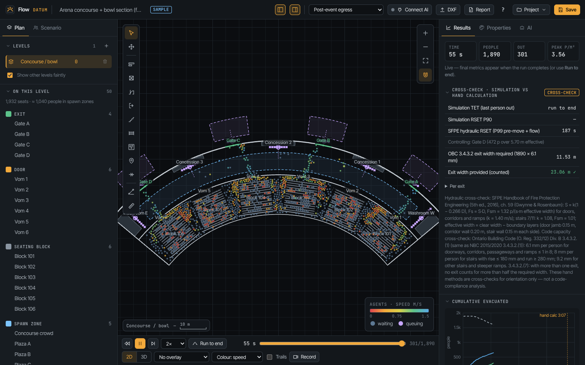
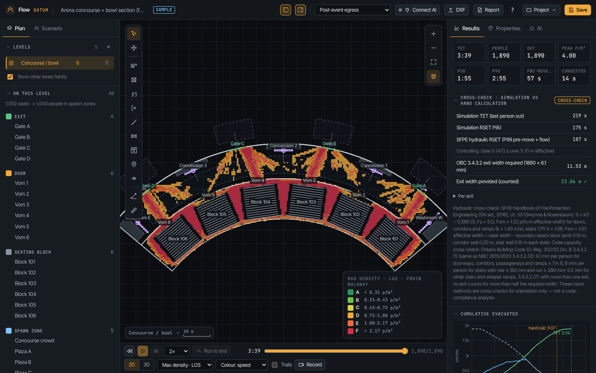
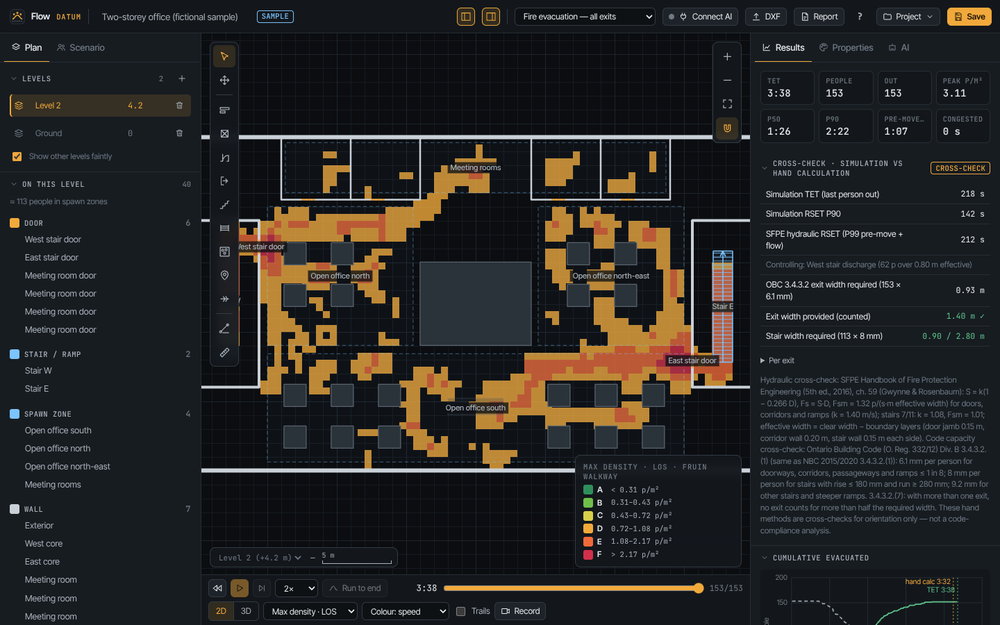
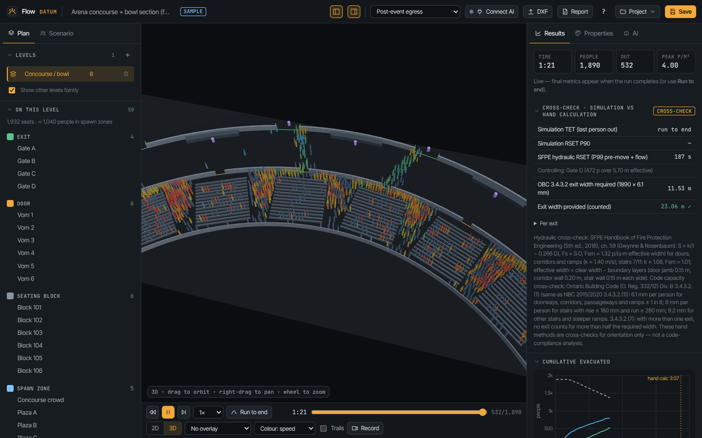
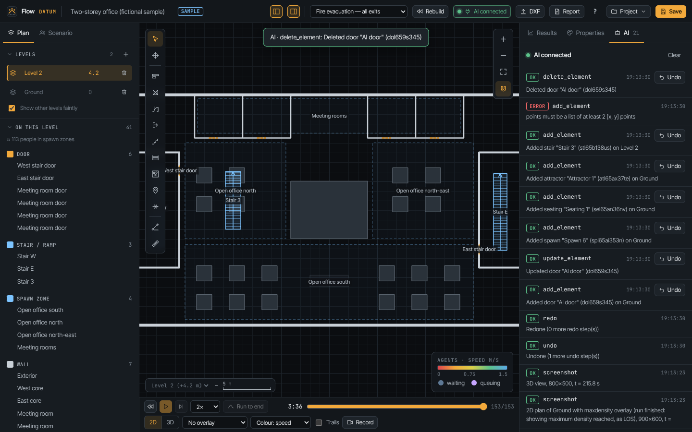

# Datum Flow

**Open-source crowd, egress and pedestrian-movement simulation in the browser for QED Architecture & Engineering.** Version 1.1 adds AI control over MCP (see [AI control](#ai-control-mcp)).
Draw or import a multi-level plan, place people, seats, service points and exits, and watch a social-force crowd find its way out, in, or around. Flow measures densities and Level of Service, flows through every door, queues, exit use and total evacuation time, and puts a hand calculation (SFPE hydraulic method and the Ontario Building Code exit-capacity rule) next to the simulation so you can see both. It runs in one self-contained HTML file with no network access.

Flow is part of the Datum suite, alongside [Datum Form](../datum-form) (3D modelling) and [Datum Atlas](../datum-atlas) (GIS). It shares the suite's dark drafting look.

> **Planning tool, not a compliance tool.** Flow is for comparing layouts and operating plans, briefing event, venue and security teams, and spotting pinch points early. It does not replace a code-compliance review or the analysis of a qualified fire-protection / life-safety engineer. The sample models are fictional.





---

## What it does

| Area | Features |
|---|---|
| **Geometry** | Multi-level plans. You can draw and edit these elements: walls (polylines, thickness), obstacles, doors (clear width, optional max flow rate in p/s, closable), exits, stairs and ramps (linking two levels, with a separate speed factor for each direction), seating blocks (generator for rows, aisles, row pitch, seat width and occupancy), spawn zones (a count or a density, a profile mix, a pre-movement distribution and groups), attractors (concessions, washrooms, gates and info points, each with servers, a service-time distribution and a queue direction), and one-way barriers. Grid snap, vertex snap and wall snap are built in, and the editor has undo and redo. |
| **DXF import** | Reads LINE, LWPOLYLINE, POLYLINE (with bulges), ARC, CIRCLE and INSERT (block references, expanded). The reader is written for Flow. A dialog maps each layer to a role: walls, obstacles, doors, exits, stairs, seating, spawn or barriers. Roles are pre-filled from AIA/NCS-style layer names, and you see a live preview. Units come from `$INSUNITS` and can be overridden. Door swings are converted to openings, and the closed edge is found against nearby walls. **Calibrate** sets the scale from two picked points and a typed distance. |
| **People** | Social force model (Helbing & Molnár 1995; Helbing, Farkas & Vicsek 2000) with floor-field navigation (fast marching). Five profiles carry cited speed and size distributions: adult, older adult, child, mobility-impaired / wheelchair and staff. Groups stay together and walk at the pace of their slowest member. Stairs have separate ascending and descending speeds. Pre-movement is log-normal, uniform, normal or fixed. Every run is reproducible from its seed. |
| **Scenarios** | **Evacuation**: everyone heads for exits, choosing either the nearest exit or the least time with congestion taken into account. **Egress after an event**: seated audiences and the concourse crowd leave. **Ingress**: arrivals pass through gate screening and then go to seats, with blocks filled by remaining capacity. **Free circulation**: people visit attractors, queue, are served and return, as in a half-time concourse. Any exit or door can be closed per scenario. A population multiplier is available. |
| **Run** | Play, pause, step and reset at 0.5×–16× or maximum speed. *Run to end* runs as fast as possible. A recorded timeline lets you scrub back through the run. **Monte-Carlo** runs N seeds in parallel workers and reports P50 / P90 / min / max of total evacuation time with a histogram. |
| **Results** | Total evacuation time (TET), P50 / P90 completion, mean pre-movement and travel time, and peak local density. You also get time spent at or above a congestion density, cumulative evacuated curve, exit usage split, flow through every door and exit over time (p/m/min), and queue lengths at attractors. A **cross-check** sets the simulation beside an SFPE hydraulic RSET and the OBC 3.4.3.2 exit-width rule. |
| **Maps** | Live density, live Fruin LOS (walkway, queuing or stairway standard), maximum density by LOS, time in congestion, and a usage heatmap. Agents can be coloured by speed, profile, local LOS or state, with optional trails. You can follow a single person. |
| **Views** | A 2D top view drawn with Canvas 2D, with agents as instanced WebGL2 discs, crisp at any zoom. A 3D view (three.js) stacks the levels at their elevations and shows people as instanced figures. You can follow an agent in either view. |
| **Output** | **PDF report** (jsPDF) with key results, the cross-check, plans with max-density LOS maps, charts, opening and attractor tables, and every assumption with its source. You can also export a **CSV** time series, a **WebM video** of the view (MediaRecorder), and **.dflow.json** project files that carry geometry, scenarios, settings and result summaries. Every file is saved through the shared Datum `download()` helper, so saving also works inside a claude.ai artifact. |
| **Phone** | A bottom sheet holds Results, Scenario, Plan and Edit, and the transport bar stays compact. You can pinch to zoom and drag to pan. |

### Samples (fictional, loaded on first run)

- **Arena concourse + bowl section** (opens running): 6 seating blocks (about 1,750 seated), 6 vomitories, a concourse with 160 people standing, 4 gates, 3 concession stands and 2 washroom blocks. It has four scenarios: *post-event egress*, *half-time concourse*, *doors-open ingress* (220 arrivals per gate through screening) and *evacuation with Gate B closed*.
- **Two-storey office**: an open-plan Level 2 with desks and meeting rooms, two stair cores discharging at ground, and ground-floor occupants. Two scenarios are included: *fire evacuation* and *east stair blocked*.
- **Small theatre**: an orchestra and a balcony, with two balcony stairs into side passages and six exits. It includes a *show-stop evacuation* scenario.





## The model in one page

Full equations, parameters and sources are in [docs/METHODS.md](docs/METHODS.md).

- **Movement.** Each person *i* accelerates toward a desired velocity *v⁰ᵢ eᵢ* with relaxation time τ. Neighbours and walls push back with an exponential "social" term *A·exp((rᵢⱼ − dᵢⱼ)/B)*. Bodies in contact add a compression term *k·g* and a sliding friction term *κ·g*. The parameters come from Helbing, Farkas & Vicsek (2000): A = 2000 N, B = 0.08 m, k = 1.2·10⁵ kg/s², κ = 2.4·10⁵ kg/(m·s), τ = 0.5 s. An anisotropy weight λ = 0.5 lets people react more to what is in front of them. Integration is semi-implicit Euler at 0.05 s with 2 force sub-steps, and speed is capped at 1.3 v⁰.
- **Navigation.** For each goal (an exit, attractor, seating block or zone) Flow solves the eikonal equation |∇T| = s(x) on a 0.25 m grid by fast marching. It uses a multi-stencil update (axis and diagonal), so diagonal error is about 2 % instead of about 8 %. Slowness rises within 0.4 m of walls so routes keep off corners. Fields are coupled between levels through stair portals. One-way barriers are enforced inside the marching. People walk down −∇T, blended bilinearly between cells.
- **Choices.** People choose the nearest exit by route time, or the least expected time *max(T/v⁰, queue ahead / exit capacity)* with hysteresis. Groups follow their leader. Attractors are chosen by walk time plus expected wait.
- **Metrics.** Density is counted on a 0.5 m grid and smoothed over a 1.5 × 1.5 m window. A cell needs at least 2 people to count, and seating blocks are excluded because LOS applies to circulation space. Flows are net crossings of each opening (people stepping back over a line cancel their crossing).

### Validation (automated, `npm test`)

| Test | Known answer | Result |
|---|---|---|
| Fast marching, empty 50 × 50 m grid, point source | Euclidean distance | max error 0.17 m (0.7 cell), ≤ 2.3 % beyond 2 m |
| Fast marching around a 30 m wall | geodesic around the wall end | 45.53 m vs 45.17 m |
| One person, 50 m corridor, v⁰ = 1.34 m/s | free speed reached; exit at d/v⁰ + τ | 1.340 m/s; 34.00 s vs 34.13 s (−0.4 %) |
| 180 people through a 1.0 m door (3 seeds) | 1.2–1.5 p/(m·s): SFPE 1.32 (effective width), Weidmann 1.22, Fruin ≈ 1.3–1.4 | 1.27, 1.33, 1.36 → **1.32 p/(m·s)** |
| Counterflow in a 5 m corridor (2 × 120 people) | lane order parameter Φ rises | Φ 0.20 → 0.41 in 20 s |
| Same seed twice / different seed | identical / different trajectories | ✓ |
| DXF with LINE, LWPOLYLINE, POLYLINE+VERTEX, ARC, CIRCLE, INSERT, layers | entity counts, coordinates, block transform | ✓ |
| Office sample: simulation vs SFPE hydraulic | similar order of magnitude | TET 218 s vs hydraulic 212 s |

**Honest limits.**
- The door flow sits in the *design* range, which is lower than many laboratory bottleneck experiments (1.6–1.9 p/(m·s), Seyfried et al. 2009). To get there, the anisotropy λ = 0.5 was calibrated. A second change also affects the result: the part of the wall repulsion that pushes *against* a person's walking direction is dropped. Without it, the isotropic HFV wall term holds people slower than about 0.9 m/s in equilibrium at door jambs.
- People blocked for more than 2 s get a small random turn of their desired direction (the HFV fluctuation term, applied only when stuck) and may squeeze to 65 % of their radius. This breaks rare symmetric deadlocks in narrow aisles.
- Each level is a 2D plan. A stair is a plan run with a speed factor, and the far end of the run hands people to the other level.
- People are circles. Wheelchairs are modelled 0.72 m wide; their length is not represented.
- Seats are filled at the block (ingress / return) rather than walked to individually.
- There is no fire, smoke, visibility or behavioural model beyond pre-movement and exit choice.
- Treat absolute times as indicative and compare options relative to one another.

### Performance

The numbers below were measured inside the web worker, in headless Chromium on the 2-vCPU build machine while other jobs were running, so treat them as lower bounds. Real-time is 20 steps/s at dt = 0.05 s.

| Agents | Steps / s | × real time | Build (fields + placement) |
|---|---|---|---|
| 5,000 (open hall, 4 exits) | **123** | 6.2× | 0.7 s |
| 20,000 (batch / *Run to end*) | **24** | 1.2× | 2.1 s |

The arena egress (1,890 people, about 220 s of simulated time) runs to completion in a few seconds.

## AI control (MCP)

New in 1.1. An AI assistant can drive Flow through the **Datum Bridge**, a small Node program on your own computer. Claude Desktop, Claude Code, Perplexity's Mac app and other MCP clients work with it. The bridge is shared by every Datum app and lives in [github.com/Nerdifitronix/datum-form](https://github.com/Nerdifitronix/datum-form) under `bridge/`. The protocol is in [docs/mcp-bridge.md](docs/mcp-bridge.md).

```bash
git clone https://github.com/Nerdifitronix/datum-form && cd datum-form/bridge && npm install
# MCP client config (Claude Desktop):  { "mcpServers": { "datum": { "command": "node", "args": ["/path/to/datum-form/bridge/dist/cli.js"] } } }
# Claude Code:                         claude mcp add datum -- node /path/to/datum-form/bridge/dist/cli.js
```

1. Open Flow from GitHub Pages or a downloaded `index.html`. The claude.ai artifact viewer blocks localhost, and Flow says so instead of failing silently.
2. Click **Connect AI** (plug icon), then enter the 6-digit pairing code the bridge printed. The code is also saved in `~/.datum-bridge/pairing-code`. The default port is 47213.
3. The status shows **AI connected**. **Pause AI** rejects calls with "paused by user". The connection retries with backoff while it is switched on.
4. Every call lands in the **AI** tab with its arguments and result. Each change has its own **Undo**, and every mutating tool is also a single ⌘Z step.

Tools appear in the MCP client as `flow_<tool>`. When the browser offers WebMCP (`navigator.modelContext`), the same tools are also registered there.

| Tool | Does |
|---|---|
| `get_state` | Model summary: levels, element counts, seats, scenarios (active marked, closed exits), run status, view |
| `screenshot` | PNG at any size. Takes `view` 2d (plan of a level) or 3d, and `overlay`: los, maxdensity, density, congestion or usage. Also `trails` and `color_by`. Each image carries a caption strip with time, scenario and LOS legend. After a finished run, `los` falls back to the maximum-density LOS map. |
| `open_sample` | Opens `arena`, `office` or `theatre` |
| `export_file` | `pdf` report (base64 + download), `csv` time series, or `dflow` model (text + download). `webm` is out of scope; use the Record button. |
| `undo` / `redo` | One model step |
| `list_elements` | Elements with ids and parameters, filtered by kind or level |
| `add_element` | Adds a wall, door (with width and max flow), exit, stair or ramp (to a level, up/down speeds), obstacle, seating block (rows, aisles, occupancy, profile mix), spawn zone (count or density, profile mix, pre-movement, groups, arrivals), attractor (type, servers, service time, queue direction) or one-way barrier |
| `update_element` / `delete_element` | Changes or removes an element by id or unique name |
| `import_dxf` | Imports DXF text, with a layer→role mapping (unlisted layers are guessed), scale, target or new level |
| `set_scenario` | Selects, creates or edits a scenario: type, seed, duration, exit choice, seated pre-movement, ingress window, gates, visit probabilities, population scale, closed exits |
| `close_exit` / `open_exit` | Blocks or re-opens an exit or door in a scenario |
| `run_simulation` | Runs from t = 0 (optional seed) until done or for N seconds, streaming progress. Returns TET, RSET (P50/P90, pre-movement, travel), per-exit usage, peak density and LOS summary per level |
| `run_monte_carlo` | n seeds in parallel workers, returning TET per seed plus P50/P90/min/max |
| `get_results` | The full results of the current or last run |
| `hand_calc` | SFPE hydraulic RSET and OBC 3.4.3.2 exit/stair width check (cross-check only) |

`src/ai/bridgeClient.ts` is a verbatim copy of the shared Datum client (identical in Form, Atlas, Field and Flow). Flow's tools are in `src/ai/tools.ts`. The test `npm run test:ai` drives every tool through an in-test WebSocket server that speaks the bridge protocol. When `../datum-form/bridge/dist/cli.js` exists (or `DATUM_BRIDGE=path`), it also runs through the real bridge with an MCP SDK client: it opens the office sample, closes an exit, runs the evacuation, reads TET and the hand calculation, takes a LOS screenshot and undoes.



## Keyboard

| Key | Action | Key | Action |
|---|---|---|---|
| Space | Play / pause | `.` | Step 0.5 s |
| 3 | Toggle 2D / 3D | V / H | Select / pan |
| W O D E | Wall, obstacle, door, exit | S B Z A N | Stair, seating, spawn, attractor, one-way |
| K / M | Calibrate scale / measure | G / F | Grid snap / fit level |
| Shift | Orthogonal while drawing | Enter, double-click | Finish wall |
| Del | Delete selection | Esc | Cancel / deselect / stop following |
| ⌘Z / ⌘⇧Z | Undo / redo | ⌘S / ⌘O | Save / open |
| ? | Shortcuts | click a person | Follow them |

## Run it

```bash
npm install
npm run dev          # http://localhost:5176
npm run build        # tsc --noEmit + one self-contained dist/index.html (≈ 1.7 MB, 0.67 MB gzipped)
```

`dist/index.html` has every dependency inlined: JS, CSS, both typefaces and the simulation worker (as a Blob). Nothing is fetched at runtime, so you can open it straight from disk, attach it to an email or publish it as an artifact.

### Tests

```bash
npm test                                            # model known-answer tests (Node, esbuild bundle)
PLAYWRIGHT_BROWSERS_PATH=/opt/pw-browsers npm run test:e2e   # headless Chromium end-to-end
PLAYWRIGHT_BROWSERS_PATH=/opt/pw-browsers npm run test:ai    # AI tools over the bridge protocol (+ the real bridge if present)
```

The e2e suite checks the following, then writes `docs/screenshots/*.png` and `test-results/e2e.json`:
- the app opens on the running arena and agents move;
- the arena egress completes;
- the office evacuation runs to completion and reports TET plus the hand calculation;
- Monte-Carlo with 3 seeds;
- the PDF report (valid `%PDF` header), CSV, WebM video and a `.dflow.json` round trip;
- a DXF generated in the test is mapped, imported and evacuated, and the Datum BIM sample plan (with block INSERTs) is parsed;
- the 3D view renders;
- worker steps per second at 5,000 and 20,000 agents;
- the phone layout has no horizontal scroll;
- no console errors.

## Architecture

```
index.html ── src/main.tsx ── App.tsx (shell: top bar, side panels / phone sheet, dialogs, drag-and-drop, boot)
  store.ts            external store (useSyncExternalStore): project, tools, selection, run status, results; undo/redo; autosave
  live.ts             mutable run buffers (latest frame, keyframes, density grids) read by the renderers, never by React
  simctl.ts           owns the simulation worker; Monte-Carlo pool; benchmark
  model/              types.ts (.dflow.json schema), defaults.ts (profiles, parameters, sources), geom.ts, samples.ts
  sim/
    world.ts          project + scenario → per-level nav grid, wall segments with openings cut, hashes, stairs, sources
    fmm.ts            multi-stencil fast marching, chamfer obstacle distance
    fields.ts         goal fields, stair-portal coupling between levels, −∇T sampling
    engine.ts         Sim: population, social force (SoA, per-level spatial hash, cell-ordered copies), exits/doors/
                      barriers/stairs, queues and servers, density / congestion / flow metrics, summary
    handcalc.ts       SFPE hydraulic RSET and OBC 3.4.3.2 width check
    worker.ts         steps the Sim on a timer; posts transferable frames + 1 s keyframes; run-to-end, batch, bench
    protocol.ts, bench.ts, rng.ts (sfc32)
  view/
    TopView.tsx       Canvas 2D plan + overlays, WebGL2 agents, interaction layer, tools, snapping, calibration
    render2d.ts       plan / overlay drawing shared by the view, video and PDF; agentsGL.ts, agentData.ts, palette.ts
    View3D.tsx        three.js scene, instanced figures, follow camera
  panels/             Plan, Scenario (+ settings, profiles), Properties, Results (+ cross-check, Monte-Carlo),
                      Transport, Legend, DXF dialog, charts.ts (SVG)
  ai/                 bridgeClient.ts (shared Datum Bridge client, verbatim), toolkit.ts, tools.ts (Flow's MCP tools), aiclient.ts
  io/                 dxf.ts (reader + layer roles), project.ts, csv.ts, report.ts (jsPDF), video.ts, download.ts (Atlas helper)
```

The worker sends typed arrays by transfer (SharedArrayBuffer is not available in the host). That covers positions, levels, states, speeds and local densities about 30 times a second, density grids every ≥ 0.5 s, and a quantised keyframe (2 cm) every simulated second for the timeline. The renderers redraw only what changed: the plan layer on view or geometry change, and the agent layer on each frame.

## Libraries and licences

| Component | Role | Licence |
|---|---|---|
| [three.js](https://threejs.org) | 3D view (OrbitControls, BufferGeometryUtils) | MIT |
| [jsPDF](https://github.com/parallax/jsPDF) | PDF report (its optional html2canvas / DOMPurify / canvg helpers are stubbed out of the build) | MIT |
| React 18, Vite 6, vite-plugin-singlefile | UI, build, single-file output | MIT |
| Inter Tight, JetBrains Mono (Fontsource) | Typefaces | OFL-1.1 |
| Playwright (dev only) | Headless end-to-end tests | Apache-2.0 |
| ws, @modelcontextprotocol/sdk (dev only) | AI end-to-end tests (mock bridge, MCP client) | MIT |

All of the simulation code, the DXF reader, charts and file formats were written for Flow. Datum Flow is released under **GPL-3.0-or-later** (see `LICENSE`), the same licence as the rest of the Datum suite.

## Known limits

- Circular bodies in 2D, one plan per level. Stairs are straight plan runs between two levels; landings and switchback flights are drawn as separate runs on intermediate levels.
- There is no fire, smoke, toxicity, visibility or alarm modelling. Pre-movement is an input distribution, not a behavioural model, and exit familiarity is not modelled.
- Monte-Carlo varies the seed only, which covers spawn positions, speeds, pre-movement and choices. Parameter sweeps are done by duplicating scenarios.
- Ingress seats people when they reach their block. Circulation sends each person to at most one attractor.
- The OBC check is the exit-capacity rule of 3.4.3.2 only. Travel distance, number of exits, exit separation, assembly-occupancy aisle rules (3.3.2) and every other requirement are out of scope.
- The DXF reader skips TEXT, DIMENSION, HATCH, SPLINE and ELLIPSE. Use polylines and arcs for walls.
- Large models are capped at 2 M navigation cells per level, and the grid coarsens automatically with a notice.
